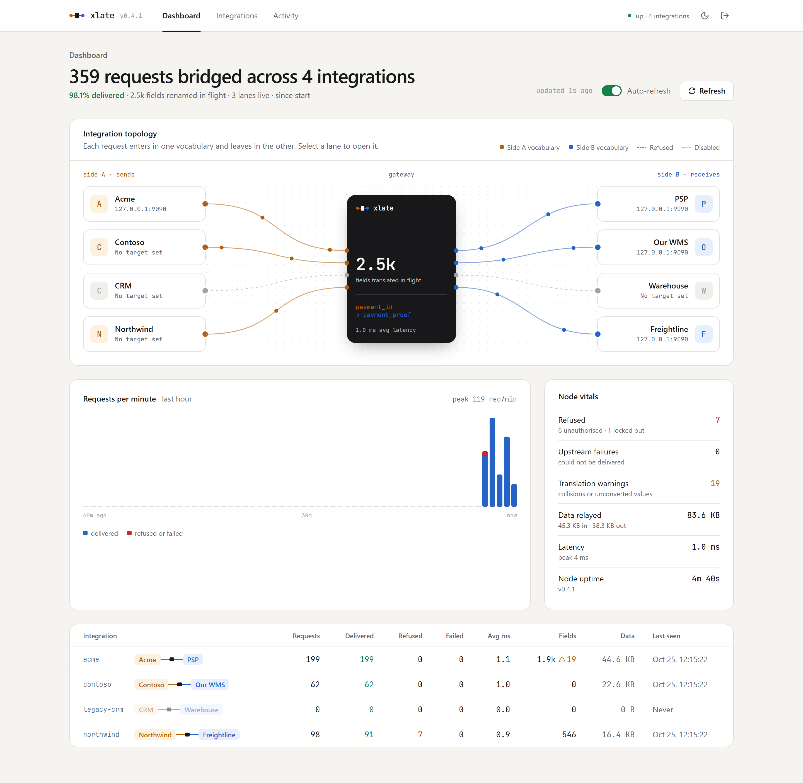
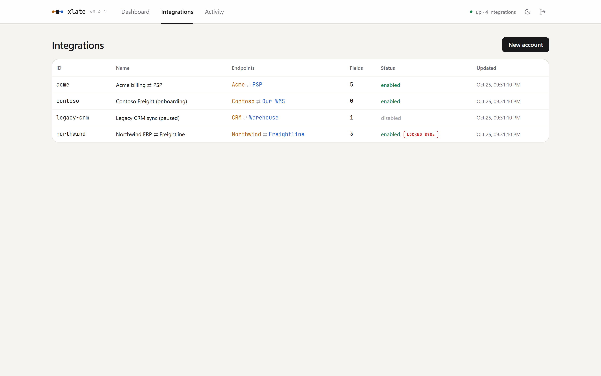
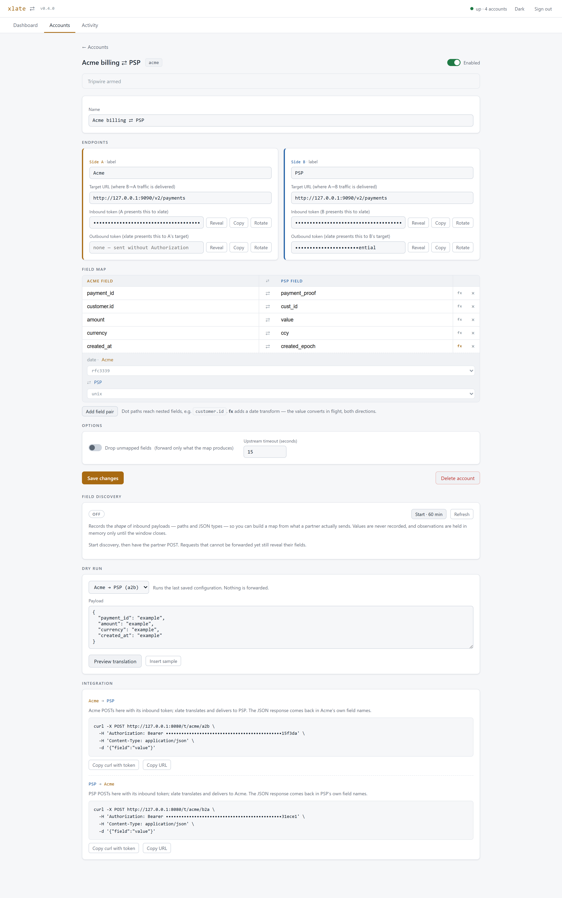
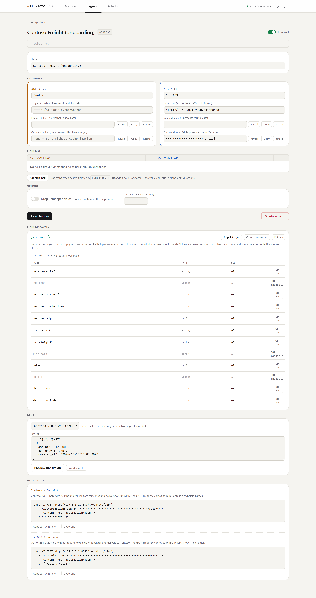
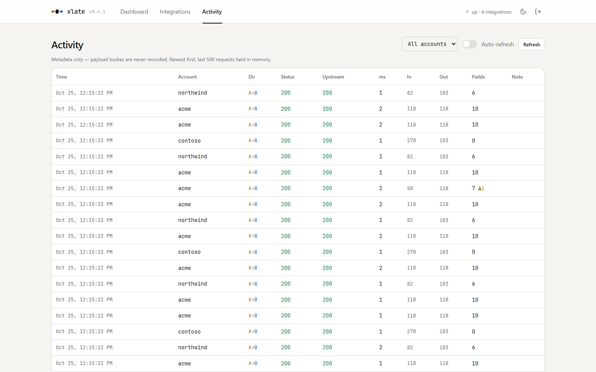
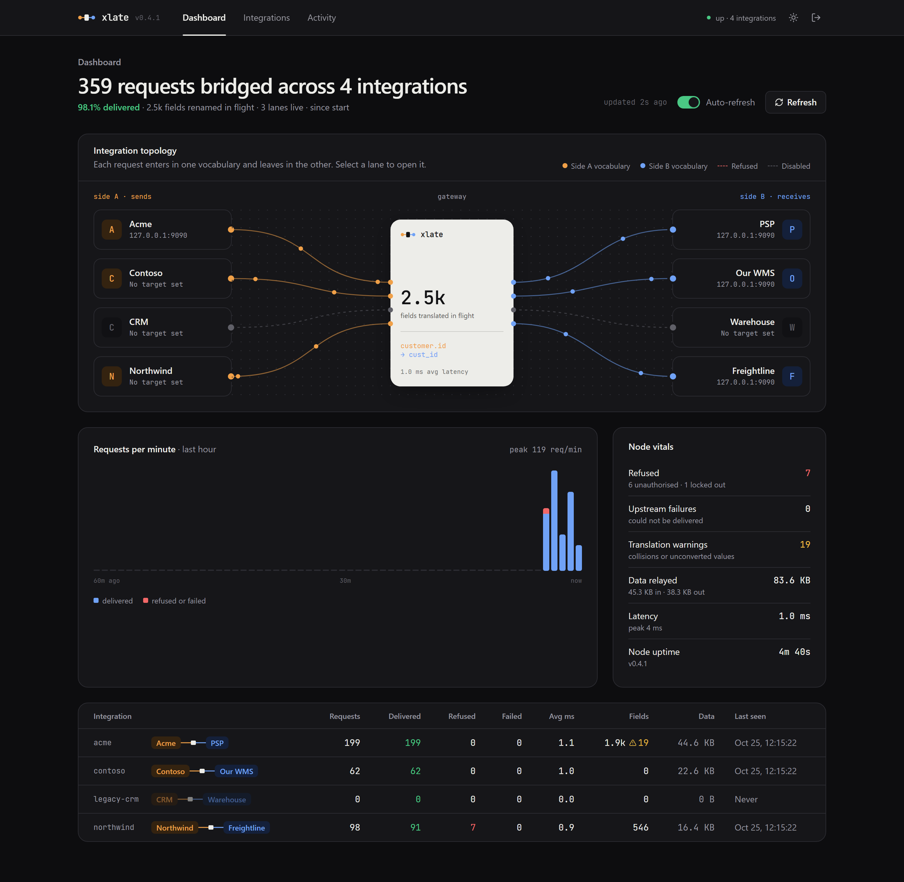

# xlate


Bidirectional REST field-translation gateway. Two systems that speak different field vocabularies POST to xlate; it renames (and optionally converts) fields per an account's map, forwards to the other side with that side's credentials, and reverse-maps the JSON response — each party only ever sees its own field names.

```
             POST /t/{account}/a2b                       POST {B.target_url}
  System A ─────────────────────────►  xlate  ─────────────────────────► System B
            Bearer A.inbound_token       │      Bearer B.outbound_token
                                         │  payment_id → payment_proof
  System A ◄─────────────────────────────┘  created_at → created_epoch (date fx)
            response reverse-mapped back into A's vocabulary

  Return leg (async/webhook style): System B POSTs to /t/{account}/b2a — same
  pipeline, mirrored.
```

Single static Go binary, standard library only. Admin console is one embedded HTML file — no build step. State is one JSON file, written durably (temp → fsync → rename → fsync the directory) with `0600` perms, and rolled back in memory if the write fails. Every security-relevant action lands on a hash-chained audit trail, and a tripwire watches for credential-guessing against any account.

New here? **[TUTORIAL.md](TUTORIAL.md)** walks you from zero to two systems talking, in about fifteen minutes.

## Quickstart

```sh
go build -o xlate .
./xlate -listen :8080
# admin token is printed on start; pin it for real use:
XLATE_ADMIN_TOKEN=... ./xlate -state /var/lib/xlate/state.json \
  -audit /var/log/xlate/trail.jsonl \
  -alert-webhook https://ops.example/hooks/xlate -alert-secret "$SECRET"
```

Open `http://localhost:8080/admin/`, sign in, create an account, add field pairs (the **fx** button on a pair adds a date transform), and hand each party its curl snippet from the Integration card. The console opens on a **Dashboard** of node counters; it ships in a light theme with a toggle in the top right, remembered per browser.

Want it populated? `./demo/demo.ps1` (or `demo.sh`) brings up the gateway, a mock destination, four dummy accounts and traffic in one command — see [demo/README.md](demo/README.md).

## A look around

Every shot below is the embedded console running the demo — no external assets, no build step.

| | |
|---|---|
| [](docs/screenshots/02-dashboard.png) *Dashboard — lifetime counters, per-minute chart, per-account rollup* | [](docs/screenshots/03-accounts.png) *Accounts — status, tripwire badges, traffic at a glance* |
| [](docs/screenshots/04-editor-acme.png) *Account editor — endpoints, field map with a date transform, dry run, integration snippets* | [](docs/screenshots/05-discovery-contoso.png) *Field discovery — a partner's vocabulary learned from live traffic, paths and types only* |
| [](docs/screenshots/06-activity.png) *Activity — one row per request, metadata only, payloads never stored* | [](docs/screenshots/07-dashboard-dark.png) *Dark theme — one toggle, remembered per browser* |

### Flags

| Flag | Default | Purpose |
|---|---|---|
| `-listen` | `:8080` | listen address |
| `-state` | `xlate.state.json` | state file path |
| `-admin-token` | *(env `XLATE_ADMIN_TOKEN`, else generated per run)* | control-plane credential; a pinned value must be 16-512 printable ASCII characters or startup fails |
| `-log-size` | `500` | activity ring buffer entries |
| `-max-body` | `2097152` | request/response body cap (bytes, min 1024) |
| `-tls-cert` / `-tls-key` | | serve HTTPS directly (both or neither) |
| `-audit` | `xlate.audit.jsonl` | hash-chained audit trail (empty disables — not recommended) |
| `-verify-audit FILE` | | verify a trail's hash chain and exit |
| `-alert-webhook` | | URL to POST tripwire alerts to |
| `-alert-secret` | *(env `XLATE_ALERT_SECRET`)* | HMAC-SHA256 key for `X-Xlate-Signature` on alerts |
| `-trip-threshold` | `5` | refused attempts tolerated per account; fires when **exceeded** (max 10000) |
| `-trip-window` | `5m` | sliding window for counting refused attempts |
| `-trip-lock` | `15m` | lockout duration in mode `lock` |
| `-trip-mode` | `lock` | tripwire action: `lock` \| `freeze` \| `alert` |
| `-trust-proxy` | `false` | trust first `X-Forwarded-For` hop (only behind a proxy that strips it) |

Flags are validated at startup, so a typo fails fast instead of producing a quietly misconfigured server.

## Data plane

`POST /t/{account_id}/{a2b|b2a}` with `Authorization: Bearer <side's inbound_token>` (or `X-Api-Key`) and a JSON **object** body.

Pipeline: tripwire gate → authenticate → validate → translate request → POST to destination `target_url` with its `outbound_token` → translate JSON object responses back → relay upstream status and body. `Idempotency-Key` and `X-Request-Id` pass through. Redirects are returned, never followed. `X-Xlate-Applied` / `X-Xlate-Warnings` headers carry translation counts for **both** legs.

The body must be exactly one JSON object — trailing bytes after it are refused rather than silently dropped, so xlate and the destination can never read the same request two different ways. Correlation headers are checked for length and header-safety before they are forwarded.

Errors are a stable envelope: `{"error": "<human>", "code": "<machine>"}`.

| Status | `code` | Meaning |
|---|---|---|
| `400` | `bad_json` | body was not a single JSON object |
| `400` | `bad_body` | body could not be read (connection dropped mid-request) |
| `400` | `validation_failed` | a correlation header was oversized or not header-safe |
| `401` | `auth_invalid` | inbound token invalid for that side (feeds the tripwire) |
| `403` | `account_disabled` | account disabled (manually or by tripwire freeze) |
| `404` | `not_found` / `bad_direction` | unknown account / direction not `a2b`\|`b2a` |
| `405` | `method_not_allowed` | wrong method; the `Allow` header lists the right ones |
| `413` | `payload_too_large` | body exceeds `-max-body` |
| `429` | `account_locked` | tripwire lockout; `Retry-After` says when to return |
| `502` | `no_target` / `upstream_failed` / `upstream_read` / `upstream_oversize` / `bad_target` | destination problems (detail in logs only) |
| `500` | `internal` | encode failure or recovered panic |

Every route answers with this envelope, including unknown paths and wrong methods.

## Mapping semantics

- A pair `{"a": "payment_id", "b": "payment_proof"}` is one bidirectional vocabulary entry; direction picks the source column.
- Names are dot-paths: `customer.id` reaches nested objects; intermediates on the destination path are created. Array indexing and keys containing literal dots are out of scope — a path containing `[` or `]` is rejected rather than quietly treated as a literal key.
- A path may not be a parent of another path on the same side: `customer` and `customer.id` together are ambiguous (extracting one shadows the other, and which wins depends on row order), so the pair is refused at config time.
- Application is two-phase (extract all sources, then assign all destinations), so swapped pairs within one map cannot clobber each other.
- Extracting the last key of a nested object leaves the empty parent in place — silently pruning containers is more surprising than an empty object.
- Missing source: no-op. Destination collision: overwritten, surfaced as a warning. Unmapped fields pass through unless **drop unmapped** is set (requests only; responses are never drop-filtered).
- Destination unreachable (an intermediate segment of the destination path exists in the payload but is not an object): the value stays at its **source** path untranslated, surfaced as a warning. On any per-field failure the original data still flows; nothing is ever dropped.
- Numbers survive verbatim (`json.Number`) — 64-bit IDs don't lose precision.

### Date transforms

A pair may carry `"transform": {"kind": "date", "a_format": ..., "b_format": ...}` — the value converts in flight, not just the name. Direction-aware and symmetric: a2b parses with `a_format` and renders with `b_format`; the return leg un-converts, so each side keeps both its vocabulary *and* its representation.

Formats: named (`rfc3339`, `rfc3339nano`, `date`, `datetime`, `rfc1123`), epoch (`unix`, `unix_ms` — accepted as number or string, rendered as a JSON number), or any raw Go reference layout (`02/01/2006 15:04`). Zoneless layouts parse as UTC.

Formats are validated when the account is saved, not when traffic arrives. A layout must round-trip a whole calendar date. This rejects the two things people actually type — `YYYY-MM-DD` (a strptime/moment.js habit; Go's `Format` treats it as a literal) and `iso8601` (Go reads the `1` as a month, so it formats and parses happily while encoding nothing) — along with partial layouts like `2006` or `15:04:05` that would invent a date on the way back. Without this check a typo is accepted at save time and then fails open on **every** request forever.

Parse failures at request time **fail open**: the value forwards untransformed and the failure surfaces as a warning (`X-Xlate-Warnings` + logs), on the request leg and the return leg alike. Rejecting a whole request over one bad date is the worse default for a pass-through gateway; a strict mode is a roadmap knob.

## Control plane

All under `Authorization: Bearer <admin token>`:

| Route | Purpose |
|---|---|
| `GET/POST /api/admin/accounts` | list / create |
| `GET/PUT/DELETE /api/admin/accounts/{id}` | read / replace / remove |
| `POST /api/admin/accounts/{id}/rotate` | `{"side":"a\|b","kind":"inbound\|outbound"}` → new token |
| `POST /api/admin/accounts/{id}/test` | dry run: translated preview (transforms included), nothing forwarded |
| `POST /api/admin/accounts/{id}/tripwire/reset` | clear counter, lock, and tripped flag |
| `GET /api/admin/tripwire` | tripwire state for all accounts |
| `GET /api/admin/logs?account=&limit=` | activity ring, newest first |
| `GET /api/admin/stats` | node counters for the dashboard |
| `GET/POST/DELETE /api/admin/accounts/{id}/discover` | read / open-close / clear field discovery |
| `GET /healthz` | unauthenticated liveness |

Blank token fields on `PUT` retain stored values. An omitted `enabled` retains the stored value too (and enables on create) — the same rule: omission must never silently flip a live account. To intentionally **clear** an outbound token (forward without `Authorization`), send the literal string `none` — unambiguous, since real tokens have a 16-character minimum; the console does this when you empty the field. Account IDs are immutable (`^[a-z0-9][a-z0-9_-]{0,62}$`); the path is authoritative. All mutations are audited, **including rejected ones**.

Admin-plane statuses: `400 validation_failed`, `401 unauthorized`, `404 not_found`, `405 method_not_allowed`, `409 already_exists`.

### Request validation

Bodies are decoded strictly. **Unknown fields are rejected** — a typo like `target_uri` or `droppunmapped` would otherwise be silently ignored and the setting lost, which for a config API is a data-loss bug wearing a `200 OK`. Trailing data after the JSON value is rejected, non-JSON `Content-Type` is rejected when one is supplied, and bodies are capped at 1 MiB.

Validation is exhaustive rather than fail-fast: one `PUT` of a broken mapping grid returns every bad row at once, each located by a JSON path.

```console
$ curl -sX POST localhost:8080/api/admin/accounts -H "Authorization: Bearer $TOK" -H "Content-Type: application/json" \
    -d '{"id":"BAD ID","timeout_sec":-1,
         "map":[{"a":"customer","b":"x"},{"a":"customer.id","b":"y"}]}'
```
```json
{
  "code": "validation_failed",
  "error": "id: must match ^[a-z0-9][a-z0-9_-]{0,62}$; timeout_sec: must be between 1 and 300 seconds (0 selects the default of 15); map[1].a: conflicts with \"customer\" on side a (map[0]): one path is a parent of the other",
  "fields": [
    {"field": "id",          "message": "must match ^[a-z0-9][a-z0-9_-]{0,62}$"},
    {"field": "timeout_sec", "message": "must be between 1 and 300 seconds (0 selects the default of 15)"},
    {"field": "map[1].a",    "message": "conflicts with \"customer\" on side a (map[0]): one path is a parent of the other"}
  ]
}
```

| Field | Rule |
|---|---|
| `id` | `^[a-z0-9][a-z0-9_-]{0,62}$`, trimmed before the uniqueness check |
| `name` | ≤ 200 chars, no control characters |
| `*.label` | ≤ 80 chars, no control characters |
| `*.target_url` | absolute `http(s)`, host required, ≤ 2048 chars, no embedded credentials, no fragment |
| `*.inbound_token` / `*.outbound_token` | 16–512 chars, printable non-space ASCII (they are written into an `Authorization` header) |
| `timeout_sec` | 1–300; `0`/omitted takes the default of 15. Out of range is refused, not clamped |
| `map` | ≤ 500 pairs; both sides required per row; no duplicate or parent/child paths per side |
| `map[].{a,b}` | ≤ 256 chars, ≤ 16 segments, no empty segment, no leading/trailing dot, no array indexing |
| `map[].transform` | `kind` must be `date`; both formats must be a known name, an epoch, or a round-tripping Go layout |

## Field discovery

Onboarding problem: a partner is already POSTing and you do not yet know their vocabulary, so you cannot write the map. Discovery records the **shape** of what arrives — dot-paths and JSON types — so you can wire from what they actually send.

```sh
curl -X POST localhost:8080/api/admin/accounts/contoso/discover \
  -H "Authorization: Bearer $TOK" -H "Content-Type: application/json" -d '{"minutes":60}'
# ...partner sends a request, even one that cannot be forwarded yet...
curl localhost:8080/api/admin/accounts/contoso/discover -H "Authorization: Bearer $TOK"
```

```json
{"path": "customer.accountNo", "types": ["string"], "count": 1, "mappable": true}
{"path": "lineItems",          "types": ["array"],  "count": 1, "mappable": false}
```

The response also carries `suggest`, a set of starter mapping rows built from the mappable paths. Shapes appear on the activity log entry too.

In the console, the account editor has a **Field discovery** card: start or stop the window, see every observed path with its type and how often it arrived, and click **Add pair** to drop one straight into the field map with the other side left blank to fill in. Paths a map cannot address — containers, arrays, collapsed identifier maps — are listed but marked *not mappable*.

It records **paths and types, never values**. That distinction is the whole design: field names are schema, field values are the payment identifiers and PII this gateway exists to pass through without reading. *Bodies are never captured* stays true. Three further guards, because the input is partner-controlled:

- **Off by default and time-boxed** (24 h ceiling). It expires on its own, so nobody leaves it on and forgets.
- **In memory only.** Observations never reach the audit trail or the state file, so they cannot outlive the process or land in a backup. Closing the window forgets them.
- **Identifier-keyed objects are collapsed, not enumerated.** JSON like `{"balances":{"cust-91@example.com":…}}` puts data in the key position; an object with more than 64 sibling keys is recorded as `balances.{*}` instead. That threshold is a heuristic and the trade-off is real — set it lower and ordinary wide records (40-field payment objects are common) collapse to nothing useful. The residual case is covered by the other two guards.

The `no_target` check runs *after* decoding so an unwired account still yields its schema: a request you cannot forward is still one you can learn field names from. Opening and closing the window is audited (`account.discover`).

## Dashboard

`GET /api/admin/stats`, and the console's landing tab. Lifetime counters for the node — total requests, delivered, refused (split into unauthorised and locked out), upstream failures, fields translated, warnings, bytes relayed, average and peak latency, uptime — plus a per-account rollup and a rolling per-minute series for the last hour.

The activity ring answers *what just happened* and holds only the last `-log-size` requests. These counters answer *what has this node done*, which the ring cannot: it forgets. They are in-memory and reset on restart, deliberately — durable metrics belong in whatever scrapes the node, not in a gateway trying to stay a single dependency-free binary. Counters only: no payloads, no identifiers.

## Audit trail

Append-only JSONL at `-audit`, opened `0600`. Records are **hash-chained**: each carries `prev` (the prior record's hash) and `hash` (SHA-256 over its own canonical serialization). Insertion, deletion, edit, or reorder breaks the chain from that point forward:

```sh
xlate -verify-audit /var/log/xlate/trail.jsonl
# audit chain OK: 13 records, tail 5dc072ac0ffb…
```

Restarts extend the chain (the tail is recovered on open), so one file spans process lifetimes. Security-relevant events (`tripwire.*`, `account.*`, `alert.*`, `server.*`, denials) are fsynced per record; routine `ingest.ok` records are flushed and rely on the OS.

Events: `server.start/stop/panic`, `account.create/update/delete/rotate/frozen/rejected`, `ingest.ok/denied/blocked/error`, `tripwire.trip/reset`, `alert.sent/failed`. Ingest records carry metadata only (account, direction, ip, sizes, applied/warning counts, upstream status). **Bodies are never captured** — this traffic routinely carries payment identifiers and PII — and **token values never appear**; rotation logs the slot, not the secret.

`account.rejected` records a refused admin mutation: method, path, ip, a `reason` (`unknown_field` / `invalid_field` / `bad_request`) and the offending field **names**. Never values — an unknown field is very often a typo'd credential field with a live credential in it (`inbound_tokenn`), and that is exactly what must not reach a log. Names are stripped of control characters and length-bounded so a client-chosen key cannot forge a log line.

Tamper-evidence is not tamper-*proofing*: an attacker with write access and the code can rebuild the chain. It reliably catches casual edits and truncation; for stronger guarantees, ship the trail off-host (it's line-oriented JSONL — any log shipper works) and compare tails.

## Tripwire & alerts

Refused attempts (401s) are counted per account over a sliding `-trip-window`. When the count **exceeds** `-trip-threshold` (default: the 6th failure in 5 minutes), the tripwire fires — once per trip:

1. **Audit** — `tripwire.trip` is written and fsynced *first*; the forensic record exists before anything that can fail or block.
2. **Alert** — POST to `-alert-webhook` with account, count, window, first/last timestamps, top offending IPs, mode, and action taken. Signed with `X-Xlate-Signature: sha256=<hex HMAC>` over the raw body when `-alert-secret` is set. Delivery is async with one retry; outcomes land on the trail (`alert.sent`/`alert.failed`).
3. **Containment** per `-trip-mode`:
   - `lock` — ingest answers `429` + `Retry-After` to *everyone*, valid credentials included, until `-trip-lock` expires; then the counter re-arms. The lock is in-memory: a restart clears it.
   - `freeze` — the account is persisted disabled (`403` until an admin re-enables). Survives restart. Stays tripped until an admin resets: authentication is checked before the enabled flag, so a bad token still answers `401`, and re-alarming on it would be noise.
   - `alert` — notify only. Re-arms once the window drains fully, so a later campaign alerts again rather than the account alerting once per process lifetime.

The cumulative trip count (`trip_number` in alerts, `trips` in the admin API) survives a re-arm — an account on its fifth trip is a different conversation from one on its first.

Design notes: the gate sits **in front of** authentication — during an active credential-guessing burst the safe state is closed. The tripping attempt itself still receives `401`; everything after answers `429`. Only 401s feed the counter (a disabled account hammered with 403s can't succeed differently, and counting them would re-alarm forever). Trigger counting is per-account, not per-IP, so rotating sources doesn't evade it; per-IP tallies ride along in the alert for attribution. One shared NAT can't false-trip an account — legitimate users don't generate 401 floods.

**Retention.** Both dimensions of tripwire state are bounded, because both are sized by attacker traffic: at most `-trip-threshold`+1 timestamps per account (only the newest can change the verdict) and at most 1024 distinct source IPs (past that, known addresses keep counting and new ones are ignored — the tally is forensic colour for the alert's top-5, not a trigger). `count` therefore saturates at threshold+1. Without these caps a sustained `401` flood grew the state without limit and made every refused attempt re-scan it, which is quadratic work under exactly the attack the tripwire exists to detect.

Admin: `GET /api/admin/tripwire` (state for every account), `POST /api/admin/accounts/{id}/tripwire/reset`. The console badges LOCKED/TRIPPED/FROZEN accounts and offers reset in the editor.

## Performance

Measured on an i9-11900K (8 cores / 16 threads, Windows), xlate and a mock upstream both on loopback. Reproduce with `make bench` and `make load`.

| Concurrency | Throughput | p50 | p95 | p99 |
|---|---|---|---|---|
| 1 | 682 req/s | 1.3 ms | 2.3 ms | 2.8 ms |
| 8 | 1 981 req/s | 3.7 ms | 6.7 ms | 8.4 ms |
| 32 | **3 544 req/s** | 7.3 ms | 19.4 ms | 27.6 ms |
| 128 | 2 241 req/s | 7.9 ms | 120 ms | 165 ms |

Throughput peaks around 32 in-flight requests and degrades past it, so cap concurrency there rather than letting it grow unbounded.

Translation itself is not the cost. The engine is roughly a microsecond:

| Operation | Cost |
|---|---|
| `Translate` (5 pairs, nested, one date fx) | 1.1 µs |
| JSON decode of a typical payload | 3.8 µs |
| Token comparison (constant-time) | 0.25 µs |
| Tripwire gate / record | 14 ns / 80 ns |
| Audit write, buffered (`ingest.ok`) | 30 µs |
| **Audit write, fsynced (denials, `account.*`)** | **1.4 ms** |

Two consequences worth knowing before you deploy:

- **A successful request is dominated by the outbound call**, not by xlate. Your real ceiling is the destination's latency and connection pool, and the per-account `timeout_sec` bounds how long a slow destination can tie up a request.
- **Refused requests are fsync-bound.** `ingest.denied` and `ingest.blocked` are security-relevant, so each is fsynced, and `AuditLog` serialises on one mutex. That puts the 401 and 429 paths at roughly **700 req/s** — slower than the success path — and a burst of them will queue behind the same mutex that successful requests use for their own audit write. Note that a tripwire lockout does not relieve this: it converts fsynced 401s into fsynced 429s at the same cost. If you expect to absorb credential-guessing floods at volume, put a rate limiter in front (the tripwire is an anomaly detector, not a limiter), or move the trail to faster storage. Group-committing the fsync would fix it properly and is not implemented.

## Security posture (0.3)

- Token comparisons are constant-time over SHA-256 digests.
- Tokens are stored **plaintext** in the state file (outbound credentials must be reversible; inbound/admin follow for simplicity). Mitigate with file perms (`0600`) and host controls; hashing inbound + admin tokens is on the roadmap.
- Handler panics are recovered to a clean `500`; the stack goes to the server log and audit trail, never the wire. Upstream failure detail (internal topology) likewise stays in logs.
- Client IPs come from the socket peer. `-trust-proxy` opts into the first `X-Forwarded-For` hop — only enable behind a proxy that strips client-supplied XFF, because this value feeds tripwire forensics.
- Neither outbound client follows redirects: a 3xx from a destination is relayed to the caller, and one from the alert webhook counts as a failed delivery, so `X-Xlate-Signature` and the alert body never reach a `Location` target. Whole-request reads are bounded (`ReadTimeout` 30s) so a client that declares a body and stalls cannot hold a connection.
- Errors from failed forwards are redacted to `scheme://host` before they reach the activity log or the audit trail, because a target URL can carry a credential in its query string.
- The forwarding client honours `HTTP_PROXY`, `HTTPS_PROXY` and `NO_PROXY`. For `https://` targets a proxy only sees a tunnel; for `http://` targets it sees the outbound bearer token and the body. Keep those variables unset unless you mean to route egress through a proxy you trust.
- Unsigned alert webhooks are spoofable; the startup log warns if `-alert-webhook` is set without `-alert-secret`.
- Admin UI ships a strict CSP that also refuses framing (`frame-ancestors 'none'`, `X-Frame-Options: DENY`); run behind TLS. Target URLs are admin-supplied and unrestricted — an SSRF primitive if untrusted parties gain admin access; egress-filter the host if that matters.
- Credentials and correlation identifiers are validated to be header-safe before they can reach an outbound `Authorization` or pass-through header, so no admin- or partner-supplied value can smuggle CRLF into a forwarded request.
- Unknown accounts answer `404` before the tripwire is consulted, so account IDs can be probed without being counted. IDs are handed to integrators in URLs and are not secrets; metering the probe would mean allocating tripwire state for arbitrary attacker-chosen strings, which is a worse trade. Front with a rate limiter if enumeration matters to you.
- The fsync cost on refused requests (above) is a disk-I/O amplification vector for an unauthenticated caller. Bounded by whatever rate limiter sits in front.
- Field discovery walks partner-controlled JSON. Depth, path count, key length and sibling count are all bounded; keys are stripped of control characters before they can reach a log line or the console; nothing is written to the trail or the state file. It is off by default and expires on its own. See *Field discovery* above for the one residual case (a small identifier-keyed object below the sibling threshold).

## Deploying

```sh
docker build -t xlate:0.4.0 .
docker run -d --name xlate -p 8080:8080 \
  -e XLATE_ADMIN_TOKEN="$(openssl rand -hex 32)" \
  -v xlate-data:/var/lib/xlate xlate:0.4.0
```

The image is `distroless/static` running as `nonroot`: the binary, CA certs, and nothing else — no shell, no package manager. State and the audit trail live on the mounted volume. A named volume (as above) inherits the correct ownership from the image; with a **bind mount** instead, `chown 65532:65532` the host directory first or the non-root process cannot create its files.

For systemd, [`deploy/xlate.service`](deploy/xlate.service) and [`deploy/xlate.env.example`](deploy/xlate.env.example) ship a hardened unit — dedicated user, `ProtectSystem=strict`, `ReadWritePaths` limited to the two directories it writes, `UMask=0077`, and credentials in an `EnvironmentFile` so they never appear in `ps`.

Either way:

- **Pin `XLATE_ADMIN_TOKEN`.** Unset, a token is generated per run and printed at startup — fine for a first look, wrong for anything that restarts.
- **Terminate TLS**, with `-tls-cert`/`-tls-key` or a proxy. TLS 1.2 is the pinned floor when serving directly.
- **Back up the state file.** It is the whole deployment, credentials included, and it is `0600` for that reason.
- **Ship the audit trail off-host.** Line-oriented JSONL; any log shipper works.
- `SIGTERM` drains in-flight requests, writes `server.stop`, and closes the trail cleanly. The drain window is sized to the largest configured account timeout plus 5s (20s with only default-timeout accounts, up to 305s if an account uses the 300s maximum) — give the supervisor at least that long before it escalates to SIGKILL.

## Durability

Writes are temp file → `fsync` → `rename` → `fsync` the directory. The rename is what makes the swap atomic, but rename alone is not durable: without the fsync a crash can leave the new name pointing at a file whose contents never reached disk.

If a write fails — full disk, read-only mount — the in-memory state is rolled back to match what is actually on disk. Otherwise the API would report an error while the change stayed live: the account would serve traffic, appear in listings, and vanish on the next restart. `Rotate` gets its own rollback because it edits the account in place; a half-applied rotation would kill the old token without persisting the new one and lock the partner out.

A corrupt or truncated state file stops the process at startup rather than quietly coming up with no accounts and refusing live traffic.

## Deliberately out of scope for 0.3

Enum/type value transforms and strict (fail-closed) transform mode, array path addressing, non-POST methods, retries/DLQ for failed forwards, HMAC signing of *data-plane* requests, per-account rate limits (tripwire is an anomaly response, not a limiter), multi-user admin (OIDC), SQLite backend, off-host audit shipping, group-committed audit fsync.

## Layout

Flat `package main` on purpose at this size — `translate.go` (pure engine), `transform.go` (date fx), `validate.go` (request decoding + field rules), `discover.go` (payload shape capture), `store.go` (state + persistence), `server.go` (HTTP), `ringlog.go` (live ops view), `stats.go` (node counters), `audit.go` (chained trail + verifier), `alerts.go` (tripwire + webhook), `main.go`, `web/admin.html` (embedded). `demo/` is scaffolding, not shipped code; its mock destination is a separate module.

## Testing

```sh
make check    # gofmt + vet + race tests + end-to-end   (what CI gates on)
make test     # unit, validation and regression tests
make e2e      # builds the binary and drives it as a subprocess
make cover    # coverage summary
make bench    # microbenchmarks
make load     # throughput probe at several concurrency levels
make docs-check  # replays TUTORIAL.md and prints the real responses
make lint     # staticcheck -checks=all
make vuln     # govulncheck
make build
```

Five suites, all in `package main`:

- **Unit** (`translate_test.go`, `feature_test.go`) — the pure engine, transforms, audit chain, tripwire.
- **Validation** (`validate_test.go`, `api_test.go`) — every field rule, and the whole REST surface driven in-process through `httptest`.
- **Regression** (`regression_test.go`, `reject_audit_test.go`, `coverage_gap_test.go`) — one test per defect found in review, plus the paths the others missed, so none of it can come back quietly.
- **Adversarial** (`adversarial_test.go`) — the data plane is reachable by a partner, not an operator, and field discovery walks whatever JSON they send. These treat that input as hostile: 5000-deep nesting, unbounded distinct keys across requests, control bytes and markup smuggled through JSON key escapes, auth on every route added late, delete-during-discovery, and the body cap after the `no_target` reordering.
- **End-to-end** (`e2e_test.go`, build tag `e2e`) — builds the binary, runs it as a real subprocess against a mock upstream, and checks the behaviour this README documents: the error table, audit tamper-evidence, signed alerts, tripwire lockout and re-arm, redirect relaying, and that no payload or credential reaches a log.
- **Benchmarks** (`bench_test.go`) — the numbers in *Performance*.

Plus `tutorial_verify_test.go` (build tag `tutorial`), which replays every step of [TUTORIAL.md](TUTORIAL.md) against a real server and prints the actual responses. Run `make docs-check` after changing anything user-visible; documentation that lies is worse than documentation that is missing.

Statement coverage is ~83%; `main()` is the only function with none, and the end-to-end suite covers it behaviourally. The e2e suite is tagged `e2e` so it stays out of `make test`: it is slower and it shells out to `go build`.
