# xlate


Bidirectional REST field-translation gateway. Two systems that speak different field vocabularies call xlate (POST, and GET, PUT, PATCH or DELETE where you allow them); it renames (and optionally converts) fields per an account's map, forwards to the other side with that side's credentials, and reverse-maps the JSON response — each party only ever sees its own field names.

```
             POST /t/{account}/a2b                       POST {B.target_url}
  System A ─────────────────────────►  xlate  ─────────────────────────► System B
            Bearer A.inbound_token       │      Bearer B.outbound_token
                                         │  payment_id → payment_proof
  System A ◄─────────────────────────────┘  created_at → created_epoch (date fx)
            response reverse-mapped back into A's vocabulary

  Return leg (async/webhook style): System B POSTs to /t/{account}/b2a — same
  pipeline, mirrored.
```

Single static Go binary, standard library only. Admin console is one embedded HTML file — no build step. State is one JSON file, written durably (temp → fsync → rename → fsync the directory) with `0600` perms, and rolled back in memory if the write fails. Every security-relevant action lands on a hash-chained audit trail, and a tripwire watches for credential-guessing against any account.

New here? **[TUTORIAL.md](TUTORIAL.md)** walks you from zero to two systems talking, in about fifteen minutes.

## Quickstart

```sh
go build -o xlate .
./xlate -listen :8080
# admin token is printed on start; pin it for real use:
XLATE_ADMIN_TOKEN=... ./xlate -state /var/lib/xlate/state.json \
  -audit /var/log/xlate/trail.jsonl \
  -alert-webhook https://ops.example/hooks/xlate -alert-secret "$SECRET"
```

Open `http://localhost:8080/admin/`, sign in with the admin token (see [Signing in](#signing-in)), create an account, add field pairs (the **fx** button on a pair adds a date transform), and hand each party its curl snippet from the Integration card. The console opens on a **Dashboard**: every integration as a lane through the gateway with its traffic drawn running both ways, the per-minute chart, node vitals and a per-integration rollup. It ships in a light theme with a toggle in the top right, remembered per browser.

Want it populated? `./demo/demo.ps1` (or `demo.sh`) brings up the gateway, a mock destination, four dummy accounts and traffic in one command — see [demo/README.md](demo/README.md).

## Signing in

The console and every `/api/admin/*` route accept one credential, the **admin token**. It is separate from the per-account partner tokens, which only work on `/t/...` and never open the console.

### Where the token comes from

At startup xlate uses the first of these that is set:

1. the `-admin-token` flag
2. the `XLATE_ADMIN_TOKEN` environment variable
3. neither: xlate generates one (`xadm_` followed by 64 hex characters from `crypto/rand`) and prints it at the end of the startup log

```text
$ ./xlate -listen :8080
2026/10/25 21:25:27 xlate 0.5.0 listening on :8080
2026/10/25 21:25:27 admin ui: http://localhost:8080/admin/
2026/10/25 21:25:27 state: xlate.state.json (0 accounts)
2026/10/25 21:25:27 audit: xlate.audit.jsonl (verify anytime: xlate -verify-audit xlate.audit.jsonl)
2026/10/25 21:25:27 tripwire: >5 refused in 5m0s -> lock
2026/10/25 21:25:27 admin token (generated for this run — pin it with -admin-token or XLATE_ADMIN_TOKEN):
2026/10/25 21:25:27   xadm_<64 hex characters>
```

The log goes to stderr: the terminal you started xlate in, `journalctl -u xlate` under systemd, or `docker logs xlate` in a container. A generated token is never written to disk, so it changes on every restart and signs out every open console. That is fine for a first look; for anything that restarts, set your own.

### Setting your own

Generate a value once and keep it wherever you keep secrets:

```sh
openssl rand -hex 32
```

```powershell
$b = [byte[]]::new(32); [Security.Cryptography.RandomNumberGenerator]::Create().GetBytes($b); -join ($b | ForEach-Object { $_.ToString('x2') })
```

Then give it to xlate through the environment:

| Where xlate runs | How |
|---|---|
| A shell | `XLATE_ADMIN_TOKEN=<token> ./xlate -listen :8080` |
| PowerShell | `$env:XLATE_ADMIN_TOKEN = "<token>"; ./xlate.exe -listen :8080` |
| systemd | `XLATE_ADMIN_TOKEN=<token>` in `/etc/xlate.env` (mode `0600`), copied from [`deploy/xlate.env.example`](deploy/xlate.env.example) |
| Docker | `docker run -e XLATE_ADMIN_TOKEN=<token> ...` (see [Deploying](#deploying)) |

`-admin-token <token>` works too, but a command line is visible to every local user in `ps`, while a process's environment is readable only by its owner and root. A token you set must be 16-512 printable ASCII characters with no spaces, or xlate refuses to start and says why. It is never printed. To rotate it, change the value and restart; every console signed in with the old one goes back to the sign-in screen.

Over plain HTTP the token crosses the network in the clear. Anywhere but loopback, terminate TLS first (`-tls-cert`/`-tls-key` or a proxy, see [Deploying](#deploying)).

### In the console

Open `/admin/`, paste the token and press **Sign in** (or Enter).

| | |
|---|---|
| [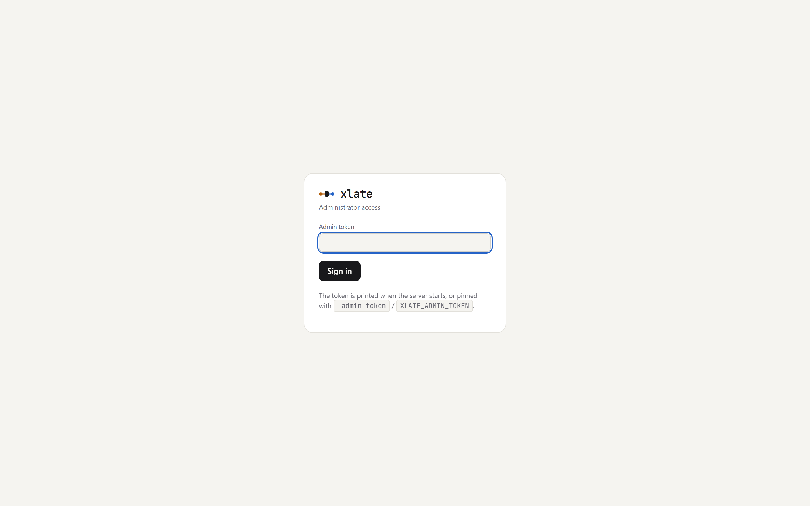](docs/screenshots/01-signin.png) *Sign-in: paste the admin token* | [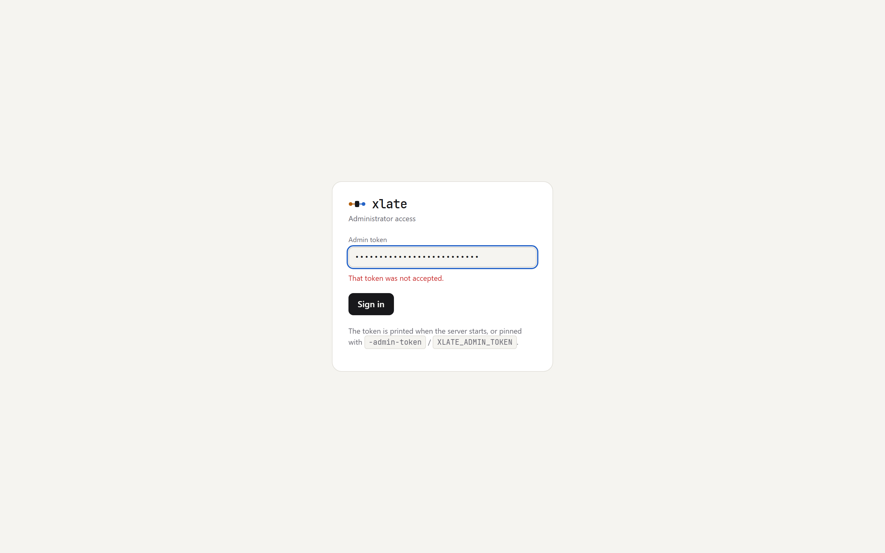](docs/screenshots/08-signin-rejected.png) *A token the server does not accept is refused, and the attempt is audited* |

The console keeps the token in that browser tab's `sessionStorage`: it survives a reload, is gone when the tab closes, and a new tab asks again. It never goes into a cookie or `localStorage`. **Sign out** (the arrow at the top right) forgets it at once. If the server stops accepting it (a restart with a new generated token, or a rotation), the console drops back to the sign-in screen. Failed sign-ins are written to the audit trail, coalesced to one record per 10 seconds.

### From scripts

```sh
curl -H "Authorization: Bearer $XLATE_ADMIN_TOKEN" http://localhost:8080/api/admin/accounts
```

Every admin route is listed under [Control plane](#control-plane).

## A look around

Every shot below is the embedded console running the demo (`./demo/demo.ps1 -Minutes 5`): no external assets, no build step.

### Dashboard

[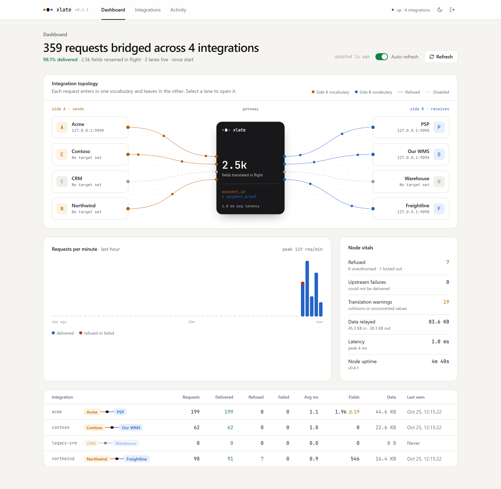](docs/screenshots/02-dashboard.png)
*Every integration as a lane through the gateway, the per-minute chart, node vitals and the per-integration rollup*

| | |
|---|---|
| [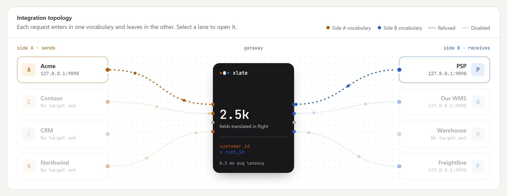](docs/screenshots/09-topology-hover.png) *Hover a lane to trace it end to end; click it to open the integration* | [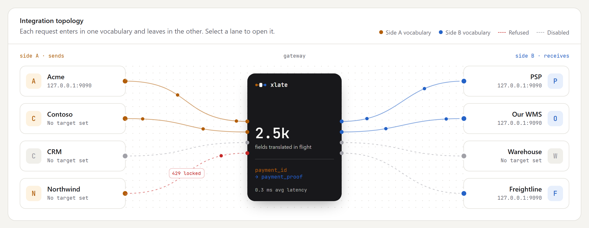](docs/screenshots/10-topology-locked.png) *A locked-out lane: refused requests stop short of the gateway* |
| [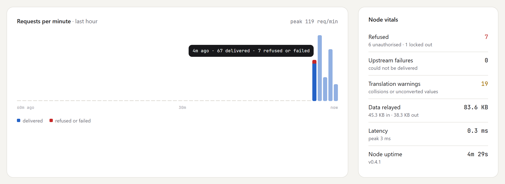](docs/screenshots/11-chart-vitals.png) *Per-minute chart with hover detail, beside the node vitals* | [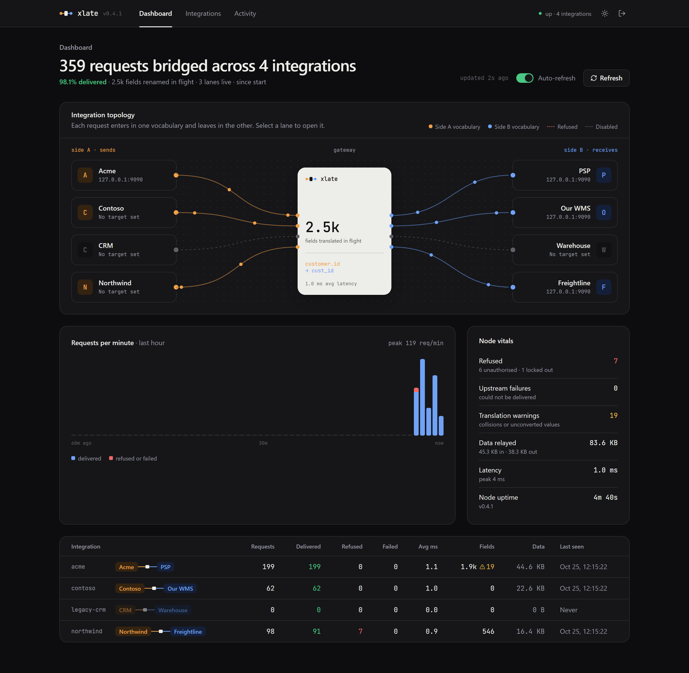](docs/screenshots/07-dashboard-dark.png) *Dark theme: one toggle, remembered per browser* |

### Integrations

| | |
|---|---|
| [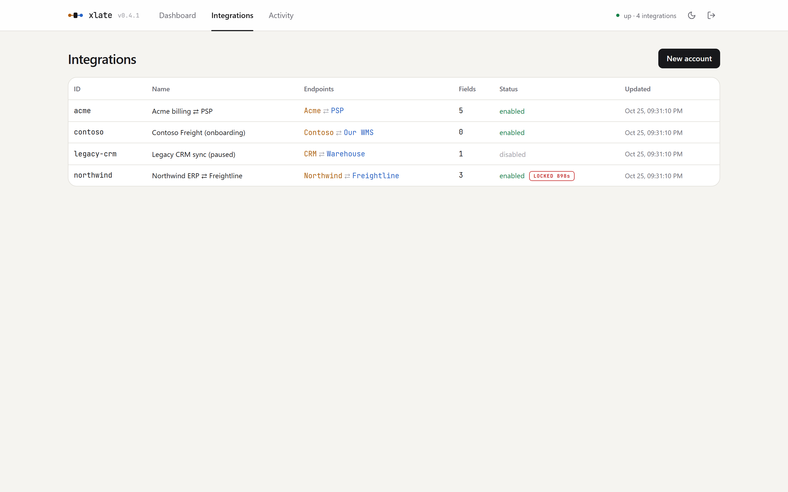](docs/screenshots/03-accounts.png) *Integrations: status, tripwire badges, field counts* | [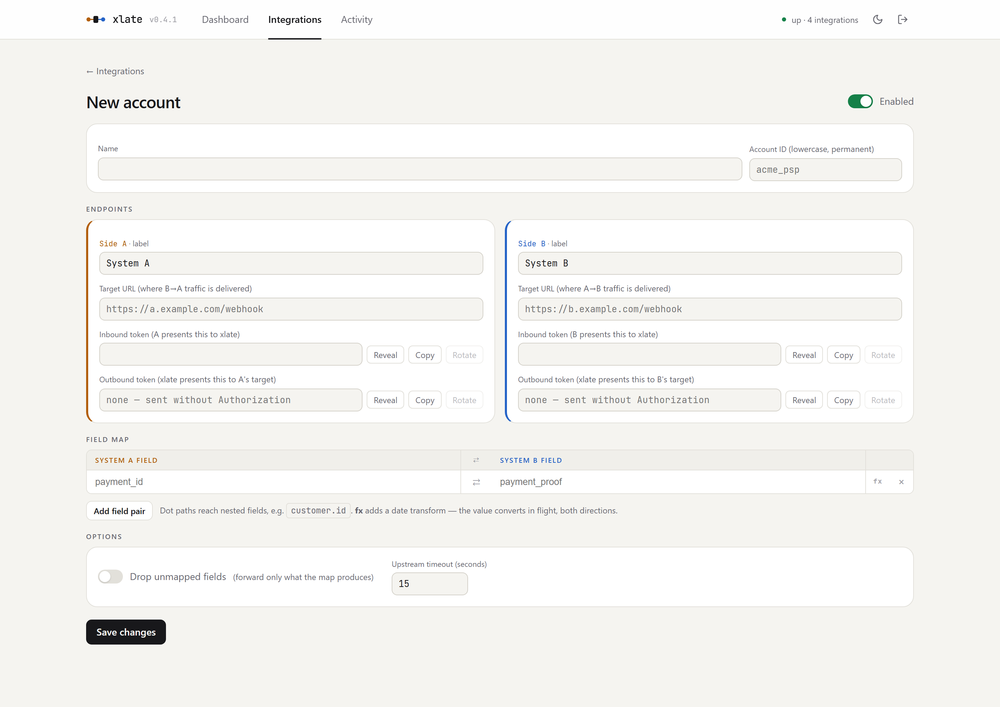](docs/screenshots/15-new-account.png) *New account: two endpoints, a field map, options* |
| [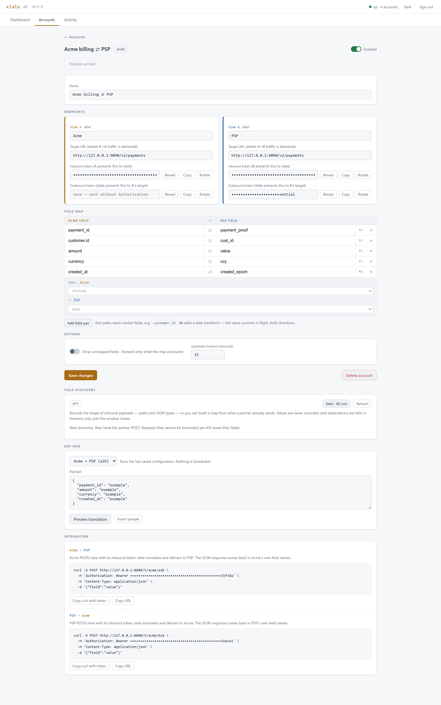](docs/screenshots/04-editor-acme.png) *Account editor: endpoints, field map with a date transform, dry run, integration snippets* | [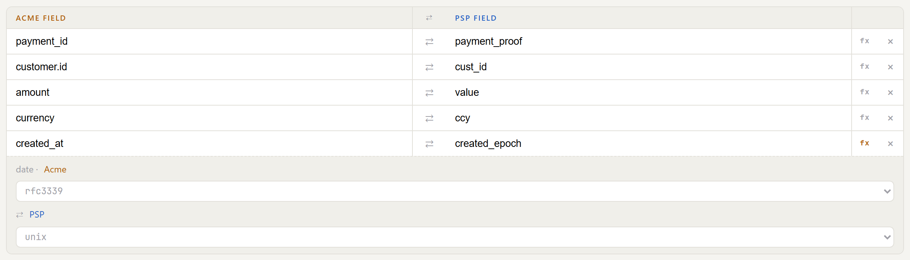](docs/screenshots/12-field-map.png) *Field map: dot paths reach nested fields; **fx** converts dates in flight* |
| [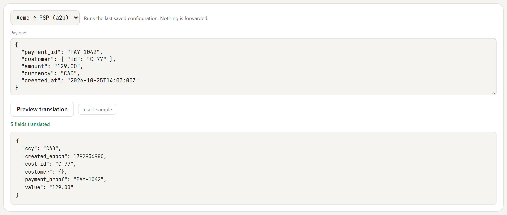](docs/screenshots/13-dry-run.png) *Dry run: the saved map applied to a sample payload, nothing forwarded* | [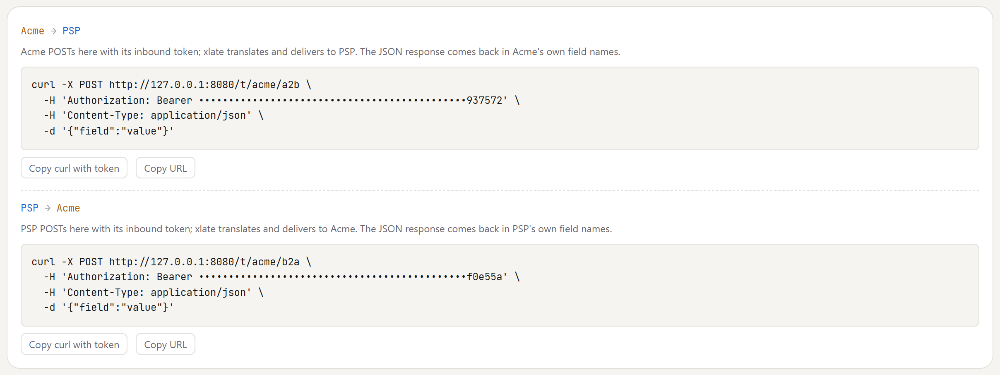](docs/screenshots/14-integration.png) *Integration snippets: each side's URL and curl call, token masked on screen* |

### Field discovery and activity

| | |
|---|---|
| [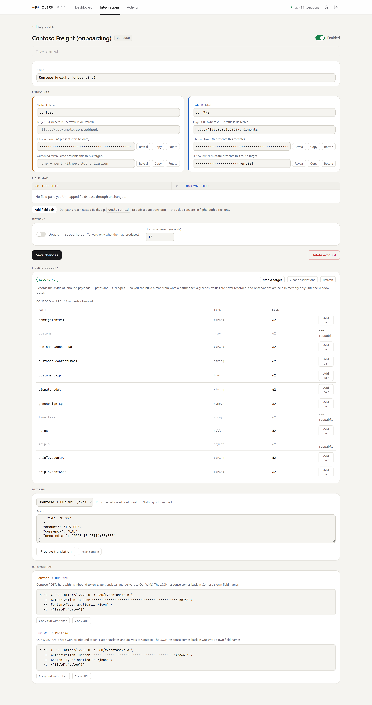](docs/screenshots/05-discovery-contoso.png) *Field discovery: a partner's vocabulary learned from live traffic, paths and types only* | [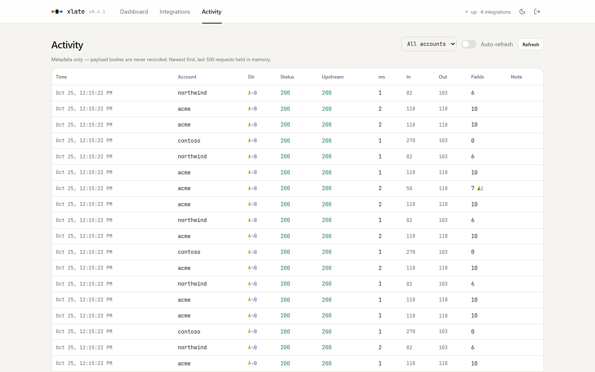](docs/screenshots/06-activity.png) *Activity: one row per request, metadata only, payloads never stored* |

### Flags

| Flag | Default | Purpose |
|---|---|---|
| `-listen` | `:8080` | listen address |
| `-state` | `xlate.state.json` | state file path |
| `-admin-token` | *(env `XLATE_ADMIN_TOKEN`, else generated per run)* | control-plane credential; a pinned value must be 16-512 printable ASCII characters or startup fails |
| `-log-size` | `500` | activity ring buffer entries |
| `-max-body` | `2097152` | request/response body cap (bytes, min 1024) |
| `-tls-cert` / `-tls-key` | | serve HTTPS directly (both or neither) |
| `-audit` | `xlate.audit.jsonl` | hash-chained audit trail (empty disables — not recommended) |
| `-verify-audit FILE` | | verify a trail's hash chain and exit |
| `-alert-webhook` | | URL to POST tripwire alerts to |
| `-alert-secret` | *(env `XLATE_ALERT_SECRET`)* | HMAC-SHA256 key for `X-Xlate-Signature` on alerts |
| `-trip-threshold` | `5` | refused attempts tolerated per account; fires when **exceeded** (max 10000) |
| `-trip-window` | `5m` | sliding window for counting refused attempts |
| `-trip-lock` | `15m` | lockout duration in mode `lock` |
| `-trip-mode` | `lock` | tripwire action: `lock` \| `freeze` \| `alert` |
| `-trust-proxy` | `false` | trust first `X-Forwarded-For` hop (only behind a proxy that strips it) |

Flags are validated at startup, so a typo fails fast instead of producing a quietly misconfigured server.

## Data plane

`/t/{account_id}/{a2b|b2a}` with `Authorization: Bearer <side's inbound_token>` (or `X-Api-Key`). A side may send POST unless the account grants it more ([Methods](#methods)). A POST, PUT or PATCH carries a JSON **object** body. A GET or DELETE carries its fields in the query string.

Pipeline: method check → tripwire gate → authenticate → rate limit → validate → translate request → send the same method to the destination `target_url` with its `outbound_token` → translate JSON object responses back → relay upstream status and body. `Idempotency-Key` and `X-Request-Id` pass through, on every method. Redirects are returned, never followed. `X-Xlate-Applied` / `X-Xlate-Warnings` headers carry translation counts for **both** legs.

The body of a POST, PUT or PATCH must be exactly one JSON object (or, where a row addresses one, one JSON array: see [Top-level arrays](#top-level-arrays)) — trailing bytes after it are refused rather than silently dropped, so xlate and the destination can never read the same request two different ways. Correlation headers are checked for length and header-safety before they are forwarded.

Errors are a stable envelope: `{"error": "<human>", "code": "<machine>"}`.

| Status | `code` | Meaning |
|---|---|---|
| `400` | `bad_json` | body was not a single JSON object (or array, where a row addresses [one](#top-level-arrays)) |
| `400` | `bad_body` | body could not be read (connection dropped mid-request) |
| `400` | `validation_failed` | a correlation header was oversized or not header-safe; a GET or DELETE carried a body; a [query string](#methods) was refused |
| `401` | `auth_invalid` | inbound token invalid for that side (feeds the tripwire) |
| `403` | `account_disabled` | account disabled (manually or by tripwire freeze) |
| `404` | `not_found` / `bad_direction` | unknown account / direction not `a2b`\|`b2a` |
| `405` | `method_not_allowed` | that side may not use this method; the `Allow` header lists the ones it may ([Methods](#methods)) |
| `413` | `payload_too_large` | body exceeds `-max-body` |
| `422` | `transform_failed` | [strict transforms](#strict-transforms), or any GET or DELETE query: a value could not be converted, nothing was forwarded |
| `422` | `array_invalid` | an [array](#arrays) the map addresses is too long, is not an array, or holds something that is not an object; nothing was forwarded |
| `429` | `account_locked` | tripwire lockout; `Retry-After` says when to return |
| `429` | `rate_limited` | that side's [rate limit](#rate-limits) is spent; `Retry-After` says when to return |
| `502` | `no_target` / `upstream_failed` / `upstream_read` / `upstream_oversize` / `bad_target` / `upstream_invalid` | destination problems (detail in logs only); `upstream_invalid` is a response refused by strict transforms or by the [array](#arrays) rules |
| `500` | `internal` | encode failure or recovered panic |

Every route answers with this envelope, including unknown paths and wrong methods.

### Methods

A side may send POST unless the account grants it more. Set `inbound_methods` on an endpoint (the console's **Allowed methods** chips) to any of `GET`, `POST`, `PUT`, `PATCH` and `DELETE`:

```json
"a": {"target_url": "https://a.example/hook", "inbound_methods": ["GET", "POST"]},
"b": {"target_url": "https://b.example/hook", "inbound_methods": ["PUT", "DELETE"]}
```

- **Per side, and replayed.** The list is what *that side* may send to xlate, and xlate sends the same method to the other side. Letting A `GET` from B does not let B `GET` from A, so a partner can be given exactly the verbs it needs. Left out, a side may only `POST`, which is what every account written before this setting means.
- **A fixed set.** `HEAD`, `OPTIONS`, `TRACE` and `CONNECT` cannot be granted. The forwarded method is picked from the five above, never from the request's own text, and override headers and parameters (`X-HTTP-Method-Override`, `_method`) are not honoured.
- **Refused early.** A method that is not on the sender's list gets `405` and an `Allow` header naming the ones that are. The check comes before the tripwire gate and before authentication, where a wrong method has always been refused. It is no credential guess, so it never feeds the tripwire, spends no rate limit and writes no audit record; the activity log shows it. A request to an unknown account is `404`, whatever the method.
- **Entries.** Case does not matter (`get` is stored as `GET`); duplicates and unknown names are refused. A `PUT` of the account that omits the list, or sends it empty, keeps the stored one. Send `["POST"]` to narrow a side back.

**POST, PUT and PATCH** carry a JSON object and are translated exactly as a POST always was. A query string on them is ignored.

**GET and DELETE** carry no body. Their query string is the input, and it goes through the same engine and the same map:

- A pair applies to a parameter of that name. With `{"a": "payment_id", "b": "payment_proof"}`, `?payment_id=1` from A reaches B as `?payment_proof=1`. A dotted name addresses the same nested field it does in a body (`customer.id` and `party.ref`), and a date transform converts the value. Swapped pairs, collisions and **drop unmapped** behave as they do for a body. An emptied container produces no parameter, so, unlike in a body, no container name crosses.
- Values are strings. A repeated name (`id=1&id=2`) crosses as a list and is renamed whole; a transform needs a single value. A name with brackets (`filter[status]`) or an empty segment is not addressable by a pair, so it passes through unmapped, or is dropped under **drop unmapped**.
- The destination's `target_url` may carry a query of its own (`https://b.example/api?key=...`). Translated parameters are appended after it, and it is sent byte for byte. A parameter with the name of one the target fixes, in any letter case, is refused with `400`: the target's value always wins, so a partner cannot replace a credential you put there.
- Also refused with `400 validation_failed`: a body on GET or DELETE, a query over 8 KiB or 100 values, a malformed one (`%zz`, `;` as a separator), and `a=1&a.b=2`, where one name is both a value and the parent of another.
- **Always strict.** A value that cannot be converted refuses the request with `422 transform_failed`, whatever `strict_transforms` says, and nothing is forwarded. A filter that fails to convert and travels on raw can be ignored by the destination, which widens what a GET returns or what a DELETE removes. The response leg follows the account's setting, as for every method.

```sh
curl -G "$XL/t/acme/a2b" -H "Authorization: Bearer $ATOK" \
  --data-urlencode 'payment_id=P-9' --data-urlencode 'created_at=2026-08-06T12:00:00Z'
```

The same for every method: the destination's own `outbound_token` is the only credential it sees, the caller's credential is never forwarded, `Idempotency-Key` and `X-Request-Id` are the only request headers that cross, the response is translated back and relayed with its status, and no query value reaches a log or the trail. Not supported: a destination path other than the configured `target_url` (xlate does not append the caller's path, so a resource such as `/orders/123` is addressed with a parameter or a field), conditional headers such as `If-Match`, and translating a response that is not a JSON object, except a top-level array where a row addresses one ([Top-level arrays](#top-level-arrays)); without such a row an array comes back unchanged, as it does for POST.

Grant `GET` or `DELETE` together with **drop unmapped** unless you want every parameter the partner sends to reach the destination.

### Rate limits

Set `"rate_limit_per_min": 600` on an account (the console's **Rate limit** field) to cap how fast each side may send. `0` or omitted means no limit, and the ceiling is 1 000 000. It is a token bucket: an idle side may burst up to one minute's allowance, then is held to the limit as tokens refill continuously (600 a minute is 10 a second). Past it, a request is refused with `429` and code `rate_limited`, `Retry-After` says how long until the next one would pass, and nothing is read or forwarded.

- **Per side.** Side A and side B each have their own bucket, so one party flooding cannot use up the other's callbacks. Every method spends from the same bucket, and a request refused with `405` spends nothing.
- **After authentication.** Only a caller holding the side's inbound token spends its allowance. Account ids are not secrets, so metering anonymous traffic would let anyone who had read one starve the partner. Credential guessing is the tripwire's job, and a limiter in front of xlate is still the right answer to a flood (see [Performance](#performance)).
- **Not an alarm.** Rate-limited requests do not feed the tripwire. They are written to the trail as `ingest.limited`, at most one record per side every 10 seconds with a count of the refusals it stands for, and the console counts them under Refused.
- **In memory, per instance.** Buckets start full after a restart or a change of the limit, and two instances behind one balancer each enforce the limit on their own.

A `PUT` that omits `rate_limit_per_min` keeps the stored value; send `0` to remove the limit.

## Mapping semantics

- A pair `{"a": "payment_id", "b": "payment_proof"}` is one bidirectional vocabulary entry; direction picks the source column.
- Names are dot-paths: `customer.id` reaches nested objects; intermediates on the destination path are created. A `[]` after a name addresses every element of an array (see [Arrays](#arrays)). Keys containing literal dots are out of scope, and so is every other use of brackets: a path containing `[` or `]` that is not the `[]` described there is rejected rather than quietly treated as a literal key.
- A path may not be a parent of another path on the same side: `customer` and `customer.id` together are ambiguous (extracting one shadows the other, and which wins depends on row order), so the pair is refused at config time. The same rule covers arrays: see [Arrays](#arrays).
- Application is two-phase (extract all sources, then assign all destinations), so swapped pairs within one map cannot clobber each other.
- Extracting the last key of a nested object leaves the empty parent in place — silently pruning containers is more surprising than an empty object.
- Missing source: no-op. Destination collision: overwritten, surfaced as a warning. Unmapped fields pass through unless **drop unmapped** is set (requests only; responses are never drop-filtered).
- Destination unreachable (an intermediate segment of the destination path exists in the payload but is not an object): the value stays at its **source** path untranslated, surfaced as a warning. On any per-field failure the original data still flows; nothing is ever dropped.
- Numbers survive verbatim (`json.Number`) — 64-bit IDs don't lose precision.

### Arrays

A `[]` after a name addresses every element of the array there, so repeated groups can be renamed element by element:

```json
{"a": "lines[].sku", "b": "items[].product_code"}
```

`{"lines":[{"sku":"s1","qty":2}]}` crosses a2b as `{"items":[{"product_code":"s1","qty":2}]}`. b2a and the return leg run the same row backwards, and a date transform on the row converts the value in every element.

- **The array moves as a unit.** It goes from its name on one side to its name on the other (`lines` becomes `items` although no row names `lines` on its own), and each element is translated by the rows under it as an object of its own. Dot paths work on both sides of the brackets: `order.lines[].tax.rate` to `invoice.rows[].vat`.
- **What stays.** An element's unmapped fields stay in it. With **drop unmapped**, only the mapped fields of each element survive, and an element left with none becomes `{}`, so no element is ever removed and positions never change; an array no row addresses is dropped like any unmapped field. Without it, an array no row addresses crosses whole and untouched, inner names included. Moving the last field out of a nested object inside an element leaves the empty object behind, as it does anywhere else.
- **Empty, ragged, null.** `[]` and `null` cross under the new name. Elements need not share keys: a mapped field an element lacks is a no-op for that element. A missing array is a no-op.
- **Syntax, checked when the account is saved.** One `[]` per path, directly after a field name (or at the very start, for a body that is itself an array: [Top-level arrays](#top-level-arrays)), with a field path after it (`lines[].sku`, `order.lines[].tax.rate`). Refused: positional indexes (`lines[0]`), `lines[]` with nothing after it (to rename the whole array use its plain name, `lines`), a second `[]` in a path (arrays inside arrays), `[]` on one side of a row only, and one array paired with two different arrays in different rows (an element's fields would be split between two arrays, and the return leg could not put them back together). The parent rule above covers arrays too: `lines` with `lines[].sku`, `lines.sku` with `lines[].sku` (one name used as an object and as an array) and `lines[].a` with `lines[].a.b` are all refused.
- **Checked on every message.** An array a row addresses is checked before anything is changed. If it holds more than 1,000 elements, is not an array (`null` is accepted), or has an element that is not an object, the message is refused: nothing is forwarded, strict transforms or not, because passing it on would show the other side the sender's field names. The length belongs to the payload, which is why this is the one array limit checked per message instead of when the account is saved. The sender gets `422` with code `array_invalid` and the paths of *its own* fields in the usual `fields` shape (`lines`, `lines[2]`), each with a reason and never a value. Arrays no row addresses are not checked. On the return leg the caller gets `502` with code `upstream_invalid` and none of the destination's response, with the same caveat as for [strict transforms](#strict-transforms): the destination has already acted. The trail records `ingest.rejected` with `reason` `array` or `response_array` and field names only, and the dry run reports `"rejected": true` with a `refused` list. A refused message is a data problem and does not feed the tripwire.
- **Counting.** `X-Xlate-Applied` counts each mapped field in each element; the array itself is not counted. Strict transforms report the element in the path (`lines[2].shipped`). A message keeps at most 1,500 warnings and 1,500 failed paths however long its arrays are; the warning count in the header stays exact, and the dry run says how many it left out (`warnings_omitted`).
- **Not supported:** arrays of scalars (`tags[]`, or a top-level `["a","b"]`), arrays inside arrays, positional indexes, and moving a field between an element and the top level. An array inside an element that no row addresses crosses whole. A query string (GET and DELETE) carries only strings, so a query parameter named like an addressed array is refused like any value that is not an array of objects.
- **Rolling back.** An xlate older than this change reads `lines[].sku` as a literal key, so a state file that holds array rows quietly stops translating arrays under it. Remove the rows before going back.

#### Top-level arrays

A path that starts with `[]` addresses the elements of a body that is itself an array, which is how a list endpoint often answers:

```json
{"a": "[].sku", "b": "[].product_code"}
```

`GET /t/acme/a2b`, with B answering `[{"product_code":"s1"}]`, gives the caller `[{"sku":"s1"}]`. It works wherever a body can be an array: the answer to any method, and the body of a POST, PUT or PATCH. Inside the elements everything is as it is for a named array.

- **Opt-in.** A bare array is handled only if some row addresses the top level on the side the message comes from; for an answer, that is the destination's side. Without such a row nothing changes: a bare request body is `400 bad_json` and a bare answer is relayed raw, in the destination's field names. Once a row does address it, the `400` says "object or array".
- **Bare on one side, wrapped on the other.** `{"a": "[].sku", "b": "data[].code"}` pairs A's bare list with B's `{"data": [...]}`. A bare list is wrapped on its way to the side that wraps. An object is unwrapped on its way to the side that does not only if its array is its only field: any other field would be lost, so the message is refused and those fields are named (`422 array_invalid` on a request, `502 upstream_invalid` on an answer). A paginated `{"data": [...], "total": 3}` therefore does not unwrap; map it as an object, with `data[].x` rows on both sides. With **drop unmapped**, a request does unwrap, and the other fields go as that setting always makes them go.
- **One map, both kinds of body.** Rows for objects and rows for a top-level array may share a map. An object ignores the `[]` rows, and a bare array ignores the others.
- **Refused as a named array is,** with the array written `[]` and its elements `[3]`: more than 1,000 elements, an element that is not an object (so `[1, 2]` is refused), and, in strict mode, `[3].shipped` for a date that cannot be converted. Nothing is forwarded and no value is reported.
- **Dry run and discovery.** The dry run takes an array as `payload` and previews it as it would be sent; it refuses one where the data plane would, for want of a row that addresses it. Discovery records a bare-array request as `[].sku`, and `[]` for an element that is not an object, so the starter rows have the form a map takes. It records what partners send to xlate, not what a destination answers, so rows for an answer are written from the destination's documentation.
- **Not supported:** a top-level array of scalars or of arrays, and an array inside the top-level array (`[].lines[].sku`).

### Date transforms

A pair may carry `"transform": {"kind": "date", "a_format": ..., "b_format": ...}` — the value converts in flight, not just the name. Direction-aware and symmetric: a2b parses with `a_format` and renders with `b_format`; the return leg un-converts, so each side keeps both its vocabulary *and* its representation.

Formats: named (`rfc3339`, `rfc3339nano`, `date`, `datetime`, `rfc1123`), epoch (`unix`, `unix_ms` — accepted as number or string, rendered as a JSON number), or any raw Go reference layout (`02/01/2006 15:04`). Zoneless layouts parse as UTC.

Formats are validated when the account is saved, not when traffic arrives. A layout must round-trip a whole calendar date. This rejects the two things people actually type — `YYYY-MM-DD` (a strptime/moment.js habit; Go's `Format` treats it as a literal) and `iso8601` (Go reads the `1` as a month, so it formats and parses happily while encoding nothing) — along with partial layouts like `2006` or `15:04:05` that would invent a date on the way back. Without this check a typo is accepted at save time and then fails open on **every** request forever.

Parse failures at request time **fail open** by default: the value forwards untransformed and the failure surfaces as a warning (`X-Xlate-Warnings` + logs), on the request leg and the return leg alike. Rejecting a whole request over one bad date is the worse default for a pass-through gateway, so failing closed is a per-account switch.

### Strict transforms

Set `"strict_transforms": true` on an account (the console's **Strict transforms** toggle) when a value in the wrong representation is worse than no message at all. A value that cannot be converted then refuses the message instead of travelling with a warning:

- **Request leg:** nothing is forwarded. The sender gets `422` with code `transform_failed` and the paths of *its own* fields that failed, in the usual `fields` shape. The destination's field names and formats, and the offending value, never appear in the response.
- **Return leg:** the destination has already acted on the request, so this cannot undo it. The caller gets `502` with code `upstream_invalid` and none of the destination's response, rather than a value in the wrong representation. xlate passes an `Idempotency-Key` through, so if the destination honours one, a retry is safe.
- Both land on the trail as `ingest.rejected` (`reason` is `transform` or `response_transform`; field *names* only, never values) and in the activity log. Neither feeds the tripwire: a partner sending bad dates is a data problem, not a credential guess.
- The dry run reports `"rejected": true` and a `failed` list when strict mode would refuse the payload.

Only value transforms are strict. A destination path blocked by a non-object value still leaves the value at its source path with a warning. A `PUT` that omits `strict_transforms` keeps the stored value; send `false` to turn it off. The query string of a GET or DELETE is always strict, whatever this setting says ([Methods](#methods)).

## Control plane

All under `Authorization: Bearer <admin token>`:

| Route | Purpose |
|---|---|
| `GET/POST /api/admin/accounts` | list / create |
| `GET/PUT/DELETE /api/admin/accounts/{id}` | read / replace / remove |
| `POST /api/admin/accounts/{id}/rotate` | `{"side":"a\|b","kind":"inbound\|outbound"}` → new token |
| `POST /api/admin/accounts/{id}/test` | dry run: translated preview (transforms included), nothing forwarded |
| `POST /api/admin/accounts/{id}/tripwire/reset` | clear counter, lock, and tripped flag |
| `GET /api/admin/tripwire` | tripwire state for all accounts |
| `GET /api/admin/logs?account=&limit=` | activity ring, newest first |
| `GET /api/admin/stats` | node counters for the dashboard |
| `GET/POST/DELETE /api/admin/accounts/{id}/discover` | read / open-close / clear field discovery |
| `GET /healthz` | unauthenticated liveness |

Blank token fields on `PUT` retain stored values. An omitted `enabled` retains the stored value too (and enables on create) — the same rule: omission must never silently flip a live account. To intentionally **clear** an outbound token (forward without `Authorization`), send the literal string `none` — unambiguous, since real tokens have a 16-character minimum; the console does this when you empty the field. Account IDs are immutable (`^[a-z0-9][a-z0-9_-]{0,62}$`); the path is authoritative. All mutations are audited, **including rejected ones**.

Admin-plane statuses: `400 validation_failed`, `401 unauthorized`, `404 not_found`, `405 method_not_allowed`, `409 already_exists`.

### Request validation

Bodies are decoded strictly. **Unknown fields are rejected** — a typo like `target_uri` or `droppunmapped` would otherwise be silently ignored and the setting lost, which for a config API is a data-loss bug wearing a `200 OK`. Trailing data after the JSON value is rejected, non-JSON `Content-Type` is rejected when one is supplied, and bodies are capped at 1 MiB.

Validation is exhaustive rather than fail-fast: one `PUT` of a broken mapping grid returns every bad row at once, each located by a JSON path.

```console
$ curl -sX POST localhost:8080/api/admin/accounts -H "Authorization: Bearer $TOK" -H "Content-Type: application/json" \
    -d '{"id":"BAD ID","timeout_sec":-1,
         "map":[{"a":"customer","b":"x"},{"a":"customer.id","b":"y"}]}'
```
```json
{
  "code": "validation_failed",
  "error": "id: must match ^[a-z0-9][a-z0-9_-]{0,62}$; timeout_sec: must be between 1 and 300 seconds (0 selects the default of 15); map[1].a: conflicts with \"customer\" on side a (map[0]): one path is a parent of the other",
  "fields": [
    {"field": "id",          "message": "must match ^[a-z0-9][a-z0-9_-]{0,62}$"},
    {"field": "timeout_sec", "message": "must be between 1 and 300 seconds (0 selects the default of 15)"},
    {"field": "map[1].a",    "message": "conflicts with \"customer\" on side a (map[0]): one path is a parent of the other"}
  ]
}
```

| Field | Rule |
|---|---|
| `id` | `^[a-z0-9][a-z0-9_-]{0,62}$`, trimmed before the uniqueness check |
| `name` | ≤ 200 chars, no control characters |
| `*.label` | ≤ 80 chars, no control characters |
| `*.target_url` | absolute `http(s)`, host required, ≤ 2048 chars, no embedded credentials, no fragment |
| `*.inbound_token` / `*.outbound_token` | 16–512 chars, printable non-space ASCII (they are written into an `Authorization` header) |
| `*.inbound_methods` | list of `GET`, `POST`, `PUT`, `PATCH`, `DELETE` (case-insensitive, no duplicates, at most 16 entries); omitted means POST only; omitted or empty on `PUT` keeps the stored list |
| `timeout_sec` | 1–300; `0`/omitted takes the default of 15. Out of range is refused, not clamped |
| `strict_transforms` | boolean, off by default; omitted on `PUT` keeps the stored value |
| `rate_limit_per_min` | integer 0–1 000 000; `0`/omitted means no limit; omitted on `PUT` keeps the stored value |
| `map` | ≤ 500 pairs; both sides required per row; no duplicate or parent/child paths per side; array rows pair one array with one array (see [Arrays](#arrays)) |
| `map[].{a,b}` | ≤ 256 chars, ≤ 16 segments, no empty segment, no leading/trailing dot; the only bracket form is one `[]` per path, as in `lines[].sku` (or `[].sku` for a body that is itself an array), with `[]` on both sides of a row or neither |
| `map[].transform` | `kind` must be `date`; both formats must be a known name, an epoch, or a round-tripping Go layout |

## Field discovery

Onboarding problem: a partner is already POSTing and you do not yet know their vocabulary, so you cannot write the map. Discovery records the **shape** of what arrives — dot-paths and JSON types — so you can wire from what they actually send.

```sh
curl -X POST localhost:8080/api/admin/accounts/contoso/discover \
  -H "Authorization: Bearer $TOK" -H "Content-Type: application/json" -d '{"minutes":60}'
# ...partner sends a request, even one that cannot be forwarded yet...
curl localhost:8080/api/admin/accounts/contoso/discover -H "Authorization: Bearer $TOK"
```

```json
{"path": "customer.accountNo", "types": ["string"], "count": 1, "mappable": true}
{"path": "lineItems",          "types": ["array"],  "count": 1, "mappable": false}
{"path": "lineItems[].sku",    "types": ["string"], "count": 1, "mappable": true}
```

The response also carries `suggest`, a set of starter mapping rows built from the mappable paths. Shapes appear on the activity log entry too.

In the console, the account editor has a **Field discovery** card: start or stop the window, see every observed path with its type and how often it arrived, and click **Add pair** to drop one straight into the field map with the other side left blank to fill in. Paths a map cannot address (containers, collapsed identifier maps, and arrays themselves) are listed but marked *not mappable*.

Arrays are walked, because a map can address their elements: the fields of an array's object elements are listed as `lineItems[].sku` and are mappable, so the starter rows already have the form a map takes. Up to 1,000 elements of an array are read and their shapes merged, and a path seen in many elements counts once per message, so *Seen* still means messages. An element that is not an object is listed as `lineItems[]` with its type, which is how a mixed array shows during onboarding, and an array inside an element is listed but not walked, since a map addresses one level of array. A request body that is itself an array is recorded as `[].sku` and `[]` (see [Top-level arrays](#top-level-arrays)).

It records **paths and types, never values**. That distinction is the whole design: field names are schema, field values are the payment identifiers and PII this gateway exists to pass through without reading. *Bodies are never captured* stays true. Three further guards, because the input is partner-controlled:

- **Off by default and time-boxed** (24 h ceiling). It expires on its own, so nobody leaves it on and forgets.
- **In memory only.** Observations never reach the audit trail or the state file, so they cannot outlive the process or land in a backup. Closing the window forgets them.
- **Identifier-keyed objects are collapsed, not enumerated.** JSON like `{"balances":{"cust-91@example.com":…}}` puts data in the key position; an object with more than 64 sibling keys is recorded as `balances.{*}` instead. That threshold is a heuristic and the trade-off is real — set it lower and ordinary wide records (40-field payment objects are common) collapse to nothing useful. The residual case is covered by the other two guards.

The `no_target` check runs *after* decoding so an unwired account still yields its schema: a request you cannot forward is still one you can learn field names from. Opening and closing the window is audited (`account.discover`).

## Dashboard

`GET /api/admin/stats`, and the console's landing tab. Lifetime counters for the node — total requests, delivered, refused (split into unauthorised, locked out and rate limited), upstream failures, fields translated, warnings, bytes relayed, average and peak latency, uptime — plus a per-account rollup and a rolling per-minute series for the last hour.

Requests are also counted by direction, as `a2b` and `b2a`, for the node and on every account row. A request counts in the direction of the route it was sent to, whatever became of it, so a refused call to `/t/{id}/b2a` is a `b2a` request and `a2b + b2a` always equals `total`. The fields are additions: every existing field keeps its name and meaning.

The topology draws each lane from those counts. Dots run A to B on a lane that has carried requests that way and B to A on one that has carried them back, both at once where it has seen both; a lane that has seen neither draws none. A locked lane shows its refusals at the side that has been knocking, or at both. Hovering a lane tags it with its two counts, the legend carries the node totals, and the rollup has a column for each direction.

The activity ring answers *what just happened* and holds only the last `-log-size` requests. These counters answer *what has this node done*, which the ring cannot: it forgets. They are in-memory and reset on restart, deliberately — durable metrics belong in whatever scrapes the node, not in a gateway trying to stay a single dependency-free binary. Counters only: no payloads, no identifiers.

## Audit trail

Append-only JSONL at `-audit`, opened `0600`. Records are **hash-chained**: each carries `prev` (the prior record's hash) and `hash` (SHA-256 over its own canonical serialization). Insertion, deletion, edit, or reorder breaks the chain from that point forward:

```sh
xlate -verify-audit /var/log/xlate/trail.jsonl
# audit chain OK: 13 records, tail 5dc072ac0ffb…
```

Restarts extend the chain (the tail is recovered on open), so one file spans process lifetimes. Security-relevant events (`tripwire.*`, `account.*`, `alert.*`, `server.*`, denials) are on disk (fsynced) before the request moves on, and concurrent ones share an fsync; routine `ingest.ok` records are written without one and rely on the OS.

Events: `server.start/stop/panic`, `account.create/update/delete/rotate/frozen/rejected`, `ingest.ok/denied/blocked/error/rejected/limited`, `tripwire.trip/reset`, `alert.sent/failed`. Ingest records carry metadata only (account, direction, method, ip, sizes, applied/warning counts, upstream status). `account.create` and `account.update` list the methods each side may send, so widening a side to DELETE shows on the trail itself. **Bodies are never captured** — this traffic routinely carries payment identifiers and PII — and **token values never appear**; rotation logs the slot, not the secret.

`account.rejected` records a refused admin mutation: method, path, ip, a `reason` (`unknown_field` / `invalid_field` / `bad_request`) and the offending field **names**. Never values — an unknown field is very often a typo'd credential field with a live credential in it (`inbound_tokenn`), and that is exactly what must not reach a log. Names are stripped of control characters and length-bounded so a client-chosen key cannot forge a log line.

Tamper-evidence is not tamper-*proofing*: an attacker with write access and the code can rebuild the chain. It reliably catches casual edits and truncation; for stronger guarantees, ship the trail off-host (it's line-oriented JSONL — any log shipper works) and compare tails.

## Tripwire & alerts

Refused attempts (401s) are counted per account over a sliding `-trip-window`. When the count **exceeds** `-trip-threshold` (default: the 6th failure in 5 minutes), the tripwire fires — once per trip:

1. **Audit** — `tripwire.trip` is written and fsynced *first*; the forensic record exists before anything that can fail or block.
2. **Alert** — POST to `-alert-webhook` with account, count, window, first/last timestamps, top offending IPs, mode, and action taken. Signed with `X-Xlate-Signature: sha256=<hex HMAC>` over the raw body when `-alert-secret` is set. Delivery is async with one retry; outcomes land on the trail (`alert.sent`/`alert.failed`).
3. **Containment** per `-trip-mode`:
   - `lock` — ingest answers `429` + `Retry-After` to *everyone*, valid credentials included, until `-trip-lock` expires; then the counter re-arms. The lock is in-memory: a restart clears it.
   - `freeze` — the account is persisted disabled (`403` until an admin re-enables). Survives restart. Stays tripped until an admin resets: authentication is checked before the enabled flag, so a bad token still answers `401`, and re-alarming on it would be noise.
   - `alert` — notify only. Re-arms once the window drains fully, so a later campaign alerts again rather than the account alerting once per process lifetime.

The cumulative trip count (`trip_number` in alerts, `trips` in the admin API) survives a re-arm — an account on its fifth trip is a different conversation from one on its first.

Design notes: the gate sits **in front of** authentication — during an active credential-guessing burst the safe state is closed. The tripping attempt itself still receives `401`; everything after answers `429`. Only 401s feed the counter (a disabled account hammered with 403s can't succeed differently, and counting them would re-alarm forever). Trigger counting is per-account, not per-IP, so rotating sources doesn't evade it; per-IP tallies ride along in the alert for attribution. One shared NAT can't false-trip an account — legitimate users don't generate 401 floods.

**Retention.** Both dimensions of tripwire state are bounded, because both are sized by attacker traffic: at most `-trip-threshold`+1 timestamps per account (only the newest can change the verdict) and at most 1024 distinct source IPs (past that, known addresses keep counting and new ones are ignored — the tally is forensic colour for the alert's top-5, not a trigger). `count` therefore saturates at threshold+1. Without these caps a sustained `401` flood grew the state without limit and made every refused attempt re-scan it, which is quadratic work under exactly the attack the tripwire exists to detect.

Admin: `GET /api/admin/tripwire` (state for every account), `POST /api/admin/accounts/{id}/tripwire/reset`. The console badges LOCKED/TRIPPED/FROZEN accounts and offers reset in the editor.

## Performance

Measured on an i9-11900K (8 cores / 16 threads, Windows), xlate and a mock upstream both on loopback. Reproduce with `make bench` and `make load`.

| Concurrency | Throughput | p50 | p95 | p99 |
|---|---|---|---|---|
| 1 | 682 req/s | 1.3 ms | 2.3 ms | 2.8 ms |
| 8 | 1 981 req/s | 3.7 ms | 6.7 ms | 8.4 ms |
| 32 | **3 544 req/s** | 7.3 ms | 19.4 ms | 27.6 ms |
| 128 | 2 241 req/s | 7.9 ms | 120 ms | 165 ms |

Throughput peaks around 32 in-flight requests and degrades past it, so cap concurrency there rather than letting it grow unbounded.

Translation itself is not the cost. The engine is roughly a microsecond:

| Operation | Cost |
|---|---|
| `Translate` (5 pairs, nested, one date fx) | 1.1 µs |
| `Translate`, one [array](#arrays) of 100 elements with 24 fields each | 0.4 ms |
| `Translate`, 500 rows over a 1 000-element array of empty objects (the cheapest hostile message, about 3 KB) | 4 ms |
| JSON decode of a typical payload | 3.8 µs |
| Token comparison (constant-time) | 0.25 µs |
| Tripwire gate / record | 14 ns / 80 ns |
| Rate-limit check (accounts with a limit only) | 47 ns |
| Audit write, buffered (`ingest.ok`) | 30 µs |
| **Audit write, fsynced (denials, `account.*`)** | **1.4 ms** |
| Audit write, fsynced, 16 concurrent callers sharing fsyncs | 0.16 ms each |

Two consequences worth knowing before you deploy:

- **A successful request is dominated by the outbound call**, not by xlate. Your real ceiling is the destination's latency and connection pool, and the per-account `timeout_sec` bounds how long a slow destination can tie up a request.
- **Refused requests cost an fsync, shared between concurrent callers.** `ingest.denied` and `ingest.blocked` are security-relevant, so each record is on disk before the request moves on, and a caller on its own still waits out a whole fsync (about 1.4 ms). Concurrent callers share: while an fsync runs the others write their records, and the next fsync makes all of them durable at once. Routine records such as `ingest.ok` no longer queue behind it. On this machine 16 concurrent refused requests went from about 750 to about 4 000 req/s (`BenchmarkIngestRejected` at 16 CPUs); on Linux, in a container on WSL2, the fsynced audit write at 16 callers fell from 1.6 ms to 0.2 ms. A tripwire lockout does not relieve the cost: it converts fsynced 401s into fsynced 429s. For credential-guessing floods at volume, put a rate limiter in front (the tripwire is an anomaly detector, not a limiter), or move the trail to faster storage. The per-account [rate limit](#rate-limits) meters authenticated callers only, so it does not help there.

## Security posture

- Token comparisons are constant-time over SHA-256 digests.
- Tokens are stored **plaintext** in the state file (outbound credentials must be reversible; inbound/admin follow for simplicity). Mitigate with file perms (`0600`) and host controls; hashing inbound + admin tokens is on the roadmap.
- Handler panics are recovered to a clean `500`; the stack goes to the server log and audit trail, never the wire. Upstream failure detail (internal topology) likewise stays in logs.
- Client IPs come from the socket peer. `-trust-proxy` opts into the first `X-Forwarded-For` hop — only enable behind a proxy that strips client-supplied XFF, because this value feeds tripwire forensics.
- Neither outbound client follows redirects: a 3xx from a destination is relayed to the caller, and one from the alert webhook counts as a failed delivery, so `X-Xlate-Signature` and the alert body never reach a `Location` target. Whole-request reads are bounded (`ReadTimeout` 30s) so a client that declares a body and stalls cannot hold a connection.
- Errors from failed forwards are redacted to `scheme://host` before they reach the activity log or the audit trail, because a target URL can carry a credential in its query string. The query a GET or DELETE appends is covered too: the full request URL is redacted first, so none of it is left behind.
- The method that is forwarded is picked from a fixed set of five, never from the request's own text, and override headers and parameters are not honoured. The caller of a GET or DELETE adds only percent-encoded query parameters: scheme, host and path stay the operator's, and a parameter that collides with one the target URL fixes is refused. Unmapped parameters pass through like unmapped fields, so grant GET or DELETE together with **drop unmapped**.
- The forwarding client honours `HTTP_PROXY`, `HTTPS_PROXY` and `NO_PROXY`. For `https://` targets a proxy only sees a tunnel; for `http://` targets it sees the outbound bearer token and the body. Keep those variables unset unless you mean to route egress through a proxy you trust.
- Unsigned alert webhooks are spoofable; the startup log warns if `-alert-webhook` is set without `-alert-secret`.
- Admin UI ships a strict CSP that also refuses framing (`frame-ancestors 'none'`, `X-Frame-Options: DENY`); run behind TLS. Target URLs are admin-supplied and unrestricted — an SSRF primitive if untrusted parties gain admin access; egress-filter the host if that matters.
- Credentials and correlation identifiers are validated to be header-safe before they can reach an outbound `Authorization` or pass-through header, so no admin- or partner-supplied value can smuggle CRLF into a forwarded request.
- Unknown accounts answer `404` before the tripwire is consulted, so account IDs can be probed without being counted. IDs are handed to integrators in URLs and are not secrets; metering the probe would mean allocating tripwire state for arbitrary attacker-chosen strings, which is a worse trade. Front with a rate limiter if enumeration matters to you.
- The fsync cost on refused requests (above) is a disk-I/O amplification vector for an unauthenticated caller. Bounded by whatever rate limiter sits in front.
- Array addressing iterates partner-controlled arrays. An addressed array may hold at most 1 000 elements and every element must be an object, or the message is refused before anything is changed or forwarded; the notes a message keeps are capped, so a hostile array cannot grow memory by the element. See *Arrays*.
- Field discovery walks partner-controlled JSON. Depth, path count, key length, sibling count and the number of array elements read are all bounded; keys are stripped of control characters before they can reach a log line or the console; nothing is written to the trail or the state file. It is off by default and expires on its own. See *Field discovery* above for the one residual case (a small identifier-keyed object below the sibling threshold).

## Deploying

```sh
docker build -t xlate:0.5.0 .
docker run -d --name xlate -p 8080:8080 \
  -e XLATE_ADMIN_TOKEN="$(openssl rand -hex 32)" \
  -v xlate-data:/var/lib/xlate xlate:0.5.0
```

The image is `distroless/static` running as `nonroot`: the binary, CA certs, and nothing else — no shell, no package manager. State and the audit trail live on the mounted volume. A named volume (as above) inherits the correct ownership from the image; with a **bind mount** instead, `chown 65532:65532` the host directory first or the non-root process cannot create its files.

For systemd, [`deploy/xlate.service`](deploy/xlate.service) and [`deploy/xlate.env.example`](deploy/xlate.env.example) ship a hardened unit — dedicated user, `ProtectSystem=strict`, `ReadWritePaths` limited to the two directories it writes, `UMask=0077`, and credentials in an `EnvironmentFile` so they never appear in `ps`.

Either way:

- **Pin `XLATE_ADMIN_TOKEN`.** Unset, a token is generated per run and printed at startup — fine for a first look, wrong for anything that restarts.
- **Terminate TLS**, with `-tls-cert`/`-tls-key` or a proxy. TLS 1.2 is the pinned floor when serving directly.
- **Back up the state file.** It is the whole deployment, credentials included, and it is `0600` for that reason.
- **Ship the audit trail off-host.** Line-oriented JSONL; any log shipper works.
- `SIGTERM` drains in-flight requests, writes `server.stop`, and closes the trail cleanly. The drain window is sized to the largest configured account timeout plus 5s (20s with only default-timeout accounts, up to 305s if an account uses the 300s maximum) — give the supervisor at least that long before it escalates to SIGKILL.

## Durability

Writes are temp file → `fsync` → `rename` → `fsync` the directory. The rename is what makes the swap atomic, but rename alone is not durable: without the fsync a crash can leave the new name pointing at a file whose contents never reached disk.

If a write fails — full disk, read-only mount — the in-memory state is rolled back to match what is actually on disk. Otherwise the API would report an error while the change stayed live: the account would serve traffic, appear in listings, and vanish on the next restart. `Rotate` gets its own rollback because it edits the account in place; a half-applied rotation would kill the old token without persisting the new one and lock the partner out.

A corrupt or truncated state file stops the process at startup rather than quietly coming up with no accounts and refusing live traffic.

## Deliberately out of scope

Enum/type value transforms, arrays of scalars and arrays inside arrays, forwarding the caller's URL path, HEAD and OPTIONS, retries/DLQ for failed forwards, HMAC signing of *data-plane* requests, multi-user admin (OIDC), SQLite backend, off-host audit shipping.

## Layout

Flat `package main` on purpose at this size — `translate.go` (pure engine), `transform.go` (date fx), `validate.go` (request decoding + field rules), `discover.go` (payload shape capture), `methods.go` (the methods a side may send), `query.go` (a query string as the payload of a GET or DELETE), `store.go` (state + persistence), `server.go` (HTTP), `ringlog.go` (live ops view), `stats.go` (node counters), `audit.go` (chained trail + verifier), `alerts.go` (tripwire + webhook), `main.go`, `web/admin.html` (embedded). `demo/` is scaffolding, not shipped code; its mock destination is a separate module.

## Testing

```sh
make check    # gofmt + vet + race tests + end-to-end   (what CI gates on)
make test     # unit, validation and regression tests
make e2e      # builds the binary and drives it as a subprocess
make cover    # coverage summary
make bench    # microbenchmarks
make load     # throughput probe at several concurrency levels
make docs-check  # replays TUTORIAL.md and prints the real responses
make lint     # staticcheck -checks=all
make vuln     # govulncheck
make build
```

Five suites, all in `package main`:

- **Unit** (`translate_test.go`, `feature_test.go`, `query_test.go`, `array_test.go`, `array_root_test.go`) — the pure engine, array addressing, transforms, audit chain, tripwire.
- **Validation** (`validate_test.go`, `api_test.go`, `methods_test.go`, `array_api_test.go`, `array_root_api_test.go`) — every field rule, and the whole REST surface driven in-process through `httptest`.
- **Regression** (`regression_test.go`, `reject_audit_test.go`, `coverage_gap_test.go`) — one test per defect found in review, plus the paths the others missed, so none of it can come back quietly.
- **Adversarial** (`adversarial_test.go`) — the data plane is reachable by a partner, not an operator, and field discovery walks whatever JSON they send. These treat that input as hostile: 5000-deep nesting, unbounded distinct keys across requests, control bytes and markup smuggled through JSON key escapes, auth on every route added late, delete-during-discovery, and the body cap after the `no_target` reordering.
- **End-to-end** (`e2e_test.go`, `methods_e2e_test.go`, build tag `e2e`) — builds the binary, runs it as a real subprocess against a mock upstream, and checks the behaviour this README documents: the error table, audit tamper-evidence, signed alerts, tripwire lockout and re-arm, redirect relaying, and that no payload or credential reaches a log.
- **Benchmarks** (`bench_test.go`) — the numbers in *Performance*.

Plus `tutorial_verify_test.go` (build tag `tutorial`), which replays every step of [TUTORIAL.md](TUTORIAL.md) against a real server and prints the actual responses. Run `make docs-check` after changing anything user-visible; documentation that lies is worse than documentation that is missing.

Statement coverage is ~83%; `main()` is the only function with none, and the end-to-end suite covers it behaviourally. The e2e suite is tagged `e2e` so it stays out of `make test`: it is slower and it shells out to `go build`.
